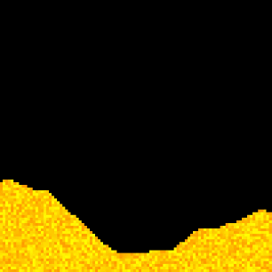

# moonsbox



A falling sand game written in C++.
Inspired by established falling sand games,
moonsbox lets you experiment with different materials
and their interactions in a 2D grid world with great performance.

The main inspiration for moonsbox is [sand:box](https://smellymoo.com/) by smellymoo, along with
[Sandboxels](https://sandboxels.r74n.com/),
[Powder Game](https://play.google.com/store/apps/details?id=jp.danball.powdergameviewer) and
[The Powder Toy](https://powdertoy.co.uk/).

## Web version

[Play web version!](https://klasterk.github.io/moonsbox/)
No need to download any executables, just **click and play**.

## Desktop version

You can play it by building the SDL3 frontend from sources.
It's slightly less functional, many things are configured only by modifying the source code.
But it's being run natively, thus, faster than the web version.

### Desktop controls

| Action                                            | Control                |
|:--------------------------------------------------|:-----------------------|
| Draw with the selected material                   | LMB, Ctrl              |
| Move the camera                                   | RMB, Shift             |
| Zoom camera                                       | Mouse Wheel            |
| Open the material palette                         | MMB, Tab               |
| Pause simulation                                  | Space                  |
| Change render mask (normal/thermal)               | V                      |
| Step simulation                                   | F5                     |
| Clean map                                         | F6                     |
| Change brush size                                 | Alt + Mouse Wheel, +/- |
| Push current material into material stack         | U, Mouse Go Forward    |
| Pop material from the stack (if empty, get Space) | I, Mouse Go Back       |
| Quit the game                                     | Esc                    |

## Features

- **Material palette**: Choose materials with a visual palette
- **Heat simulation**: Temperature exchange based on heat capacity and
                       thermal conductivity of materials
- **Sounds of gameplay**: Some materials can play sounds on interaction
- **Advanced renderer**: Zoom and heatmap display are supported
- **Saving system**: Save your progress, share your buildings, schemes or silly states
- **Standalone simulation**: Simulation can be run headless.
                             You can code a frontend for any platform

## Social

Join our community!

- For English speakers, come chat with us on [discord server](https://discord.gg/ZKDg6KHqyQ).
- Если вы знаете русский, подписывайтесь на наш [телеграм канал](https://t.me/kk_moonsbox).
  Новости там появляются быстрее, чем в дискорде.

## Building from sources

simulationengine is used by every frontend. Frontends are not depent on each other.
Building of the SDL3 frontend is well tested.
Building of the web frontend is only tested on Arch Linux.
So, if you want to build the SDL3 frontend, you should install dependencies for both
simulationengine and moonsbox and then build as written further.
Installing dependencies for webmoonsbox is not required and is useless for the SDL3 frontend.

### Dependencies

Common:

- C++23
- CMake 3.20+

simulationengine (simulation backend):

- minizip (may be disabled)
- pybind11 (optional, for Python API)

moonsbox (desktop SDL3 frontend):

- SDL3
- SDL3_ttf

webmoonsbox (web frontend):

- Emscripten SDK
- zlib

### Installing dependencies

Arch-based distros:

```sh
# Update your system
sudo pacman -Syu
# simulationengine
sudo pacman -S base-devel cmake minizip
# moonsbox
sudo pacman -S sdl3 sdl3_ttf
# webmoonsbox
yay -S emsdk # or any other AUR helper
emsdk install latest
emsdk activate latest
. emsdk_env.sh
embuilder build zlib
```

Debian-based distros:

```sh
# Update your system
sudo apt update
sudo apt upgrade
# simulationengine
sudo apt install build-essential cmake libminizip-dev
# moonsbox
sudo apt install libsdl3-dev libsdl3-ttf-dev
# webmoonsbox
# Emscripten is often obsolete in the repositories so it's better to install it (locally) using git
git clone https://github.com/emscripten-core/emsdk.git
cd emsdk
./emsdk install latest
./emsdk activate latest
. ./emsdk_env.sh
embuilder build zlib
```

Termux (without chroot):

```sh
# Update your system
sudo pkg update
sudo pkg upgrade
# simulationengine
sudo pkg install cmake make clang libminizip
# moonsbox
sudo pkg install sdl3 sdl3-ttf
# webmoonsbox
# Emscripten is often obsolete in the repositories so it's better to install it (locally) using git
git clone https://github.com/emscripten-core/emsdk.git
cd emsdk
./emsdk install latest
./emsdk activate latest
. ./emsdk_env.sh
embuilder build zlib
```

### Building and running commands

```sh
# Desktop version
git clone https://github.com/KlasterK/moonsbox.git
cd moonsbox
cmake -S. -Bbuild -DCMAKE_BUILD_TYPE=Release
cmake --build build -j
build/moonsbox/moonsbox

# Web version
emsdk activate latest # Use ./emsdk instead of emsdk if it isn't installed globally
. emsdk_env.sh
git clone https://github.com/KlasterK/moonsbox.git
cd moonsbox
emcmake cmake -S. -Bbuild-wasm -DCMAKE_BUILD_TYPE=Release
cmake --build build-wasm -j
python -m http.server &
xdg-open http://127.0.0.1:8000/webmoonsbox/index.html
```

## Credits

Carrot -- 4 material icons, telegram: @DAM3G

## License

This project is licensed under the GPL-3.0 License -- see the [LICENSE](LICENSE) file for details.
